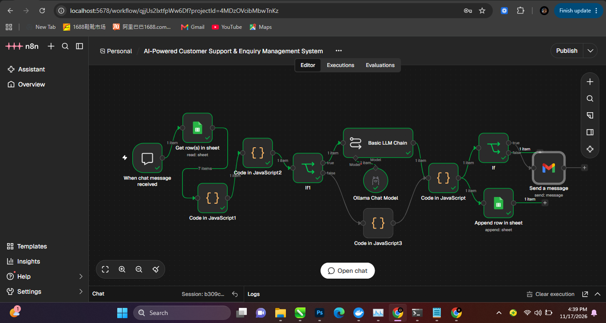

# AI-Powered Customer Support & Enquiry Management System

An AI-assisted customer support automation built with **n8n, Ollama, Google Sheets, and Gmail**.

The system processes customer enquiries, generates relevant responses using a locally hosted AI model, categorises enquiries, stores records, and alerts the business when human attention is required.

## Project Overview

Many businesses struggle to respond to customer enquiries promptly while keeping track of complaints and customer interactions.

This project demonstrates how AI and workflow automation can simplify that process by combining customer support, enquiry management, and human escalation in one workflow.

## Key Features

- **AI-powered responses:** Uses Ollama and Llama 3.2 (1B) to generate customer-facing responses.
- **Knowledge base integration:** Retrieves business information from Google Sheets to guide responses.
- **Enquiry categorisation:** Classifies enquiries into Payments, Delivery, Complaints, Orders, and General.
- **Automated record keeping:** Saves customer messages, AI responses, categories, timestamps, and statuses in Google Sheets.
- **Human escalation:** Sends Gmail notifications when a complaint requires human attention.
- **Fallback responses:** Handles enquiries when the required information is unavailable.

## Workflow Architecture

The automation follows a structured process from receiving a customer enquiry to generating a response, recording the interaction, and escalating complaints.

### Workflow Overview



## How It Works

1. Customer submits an enquiry through the n8n chat trigger.
2. The workflow retrieves business information from Google Sheets.
3. JavaScript processes the enquiry and checks for relevant knowledge base information.
4. If relevant information is found, the AI model generates a response.
5. If information is unavailable, a predefined fallback response is returned.
6. The enquiry is categorised and assigned a status.
7. The interaction is recorded in Google Sheets.
8. Complaints requiring human attention trigger an email notification.

## Technologies Used

- n8n – Workflow automation
- Ollama – Local AI model execution
- Llama 3.2 (1B) – Language model
- JavaScript – Data processing and classification
- Google Sheets – Knowledge base and enquiry database
- Gmail – Human escalation notifications

## Human-in-the-Loop Support

The system recognises complaints and flags them for human review rather than relying entirely on automated responses.

This combines automation with human judgement to support better customer service.

## Repository Structure

```text
ai-customer-support-automation/
│
├── customer-support-workflow-public.json
├── workflow-overview.png
└── README.md
```

## Setup Notes

This repository contains a sanitised n8n workflow export for demonstration and learning purposes.

To run the workflow:

1. Install and configure n8n.
2. Install Ollama and download the Llama 3.2 (1B) model.
3. Configure Google Sheets and Gmail credentials in n8n.
4. Connect the appropriate Google Sheets document and knowledge base.
5. Import the workflow JSON into n8n.
6. Review and configure the nodes before executing the workflow.

**Note:** Credentials and private configuration values are intentionally excluded. The workflow may require adjustments to match your environment.

## Project Status

Completed prototype. Demonstrated functionality includes AI-assisted enquiry handling, knowledge base lookup, enquiry categorisation, Google Sheets record keeping, and complaint escalation through email.

## Author

**Joel Damilare Ehimiaghe**

AI Automation Specialist

- [LinkedIn](https://www.linkedin.com/in/joel-ehimiaghe-5542a1385)
- [GitHub](https://github.com/JoelEhimiaghe)

*Building smarter systems. Automating better workflows.*
